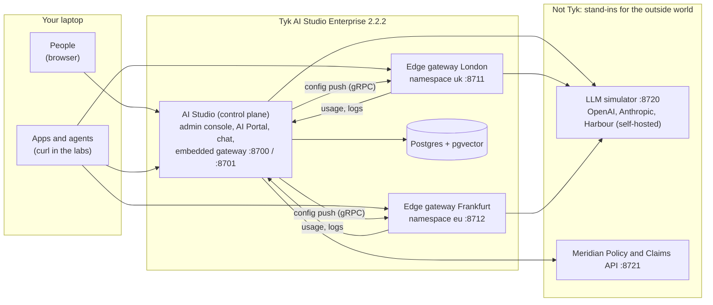

# Tyk AI Studio workshop: one week at Meridian Mutual

A hands-on, story-driven workshop and demo for **Tyk AI Studio Enterprise 2.2.2**.

You spend one working week at a fictional insurer that has an AI problem, and you fix it one day at a time:
one front door for every model, self-service access for teams, guardrails, budgets, governed tools and
knowledge, regional edge gateways, failover, and an audit trail a regulator would accept.

Everything runs on your laptop with one command. No LLM provider account is needed and nothing costs money:
the model providers are simulated locally so the workshop behaves the same every time.

| | |
|---|---|
| **Attendee guide** | [WORKSHOP.md](WORKSHOP.md): the full workshop, act by act |
| **Facilitator notes** | [FACILITATOR.md](FACILITATOR.md): run of show, timings, talking points, troubleshooting |
| **Demo video** | [video/tyk-ai-studio-workshop-demo.mp4](video/tyk-ai-studio-workshop-demo.mp4): the whole week, narrated, in under nine minutes |
| **Demo script** | [DEMO.md](DEMO.md): the same sequence for presenting live, and how the video was recorded |
| **Use a real provider** | [docs/real-providers.md](docs/real-providers.md): swap a simulated model for a live one |

## The story

**Meridian Mutual** is a mid-sized insurer with about 4,000 staff in London and Frankfurt. On Monday morning
a claims handler pasted a customer's claim, with their National Insurance number and bank account, into a
public chatbot using a key a colleague had put on an expense card. Nobody could say who sent it, what it cost,
or which model saw it. The regulator has asked Meridian a simple question:

> Which models touch customer data, who decided that, and how do you know?

Six people carry the week.

| Who | Role | What they need |
|---|---|---|
| **Priya Nair** | Head of AI Platform | One governed way for every team to use AI, by Friday |
| **Dana Okafor** | Developer, Claims UK | A working model key today, without a three-week review |
| **Tom Reyes** | Claims handler | An assistant that knows the handbook and can look up a claim |
| **Sofia Keller** | Developer, Claims EU (Frankfurt) | A model that keeps EU customer data in the EU |
| **Marcus Bell** | CISO | Proof that personal data and secrets do not reach public models |
| **Elena Rossi** | FinOps lead | Spend that stops at a limit instead of appearing on an invoice |

| Day | Act | The problem | What you build in AI Studio |
|---|---|---|---|
| Mon 08:40 | 0. The incident | AI with no front door | Nothing yet. You watch the leak happen. |
| Mon | 1. One front door | Keys on expense cards, no inventory | LLM providers, secrets, model prices, an App, one endpoint |
| Tue | 2. The right doors for the right teams | Access by ticket, or by nobody checking | Teams, catalogs, AI Portal self-service, approval |
| Wed | 3. Guardrails | Personal data and secrets in prompts | Built-in guardrails, a custom script filter, compliance events |
| Wed night | 4. Money | A runaway job found on the invoice | App, provider and team budgets, cost analytics |
| Thu | 5. Tools and knowledge | The model knows nothing about Meridian | A governed tool, a knowledge base, a chat assistant, MCP |
| Fri am | 6. Regions and resilience | EU data residency, a provider outage | Edge gateways, namespaces, failover, a model router |
| Fri pm | 7. Prove it | The regulator's question | Roles, the audit trail, the compliance overview |

## What runs



The stack is self-contained: its own Compose project (`tyk-ai-studio-workshop`), network, volumes and ports
(8700 to 8721, bound to 127.0.0.1). It does not read from, or write to, any other AI Studio on your machine.

**About the simulated providers.** `llm-sim` and `meridian-api` are small Node programs in [stack/](stack/).
They are not part of Tyk. They stand in for OpenAI, Anthropic, a self-hosted model and an internal API, so
that every lab is free, offline and repeatable. Everything the workshop teaches happens in AI Studio, in
front of them. The simulator also lets you look at exactly what a provider received
(`./workshop sim seen openai`), which is how you prove a guardrail worked. To put a real model behind the
same governance, see [docs/real-providers.md](docs/real-providers.md).

## Prerequisites

- Docker with Compose v2, and about 4 GB of free memory
- `curl`, `jq`, `openssl` and `python3` (present on macOS and most Linux systems)
- A **Tyk AI Studio Enterprise licence key**. The Enterprise images do not start without one.

## Quick start

```bash
git clone <this repository> && cd tyk-ai-studio-workshop
```

```bash
./workshop up
```

The first run creates `.env` and stops to ask for your licence. Paste it after `TYK_AI_LICENSE=` in `.env`
(the file is gitignored), then run `./workshop up` again. It starts six containers, creates the first
administrator and the people in the story, and prints the address to open.

```bash
./workshop who
```

shows the sign-in details for each person. Then open [WORKSHOP.md](WORKSHOP.md) and start at Act 0.

## Commands

| Command | What it does |
|---|---|
| `./workshop up` | Start the stack and prepare Monday morning (safe to run again) |
| `./workshop who` | Sign-in details for Priya, Dana, Tom, Sofia, Marcus and Elena |
| `./workshop act <0-7>` | Do an act for you through the API (catch up, rehearse, or compare with what you built) |
| `./workshop check <1-7>` | Verify an act is in place, with a line per requirement |
| `./workshop goto <1-7>` | Run every act up to and including this one |
| `./workshop status` | Containers, addresses, and which acts are done |
| `./workshop ask <app> <model> "<prompt>"` | Send one request through a gateway as an App (`--at london`, `--headers`, `--times 10`) |
| `./workshop runaway` | Run Act 4's buggy batch job until its budget stops it |
| `./workshop mcp` | Call the Policy and Claims tool the way an AI agent does, over MCP |
| `./workshop sim seen [provider]` | What the simulated provider actually received |
| `./workshop sim outage <provider> on\|off` | Take a provider down, or bring it back |
| `./workshop logs <service>` | Container logs (`studio`, `edge-london`, `edge-frankfurt`, `llm-sim`, `meridian-api`) |
| `./workshop down` | Stop the stack and keep the data |
| `./workshop reset` | Delete all workshop data and start again from Monday |

## Repository layout

| Path | Purpose |
|---|---|
| `workshop` | The one entry point for everything above |
| `docker-compose.yml` | The stack: AI Studio, two edge gateways, Postgres, and the two stand-ins |
| `.env.example` | Settings template. `./workshop up` copies it to `.env` and generates the local secrets |
| `scripts/acts/act0.sh` to `act7.sh` | Each act, done through AI Studio's management API. Readable, and safe to re-run |
| `scripts/check.sh` | The checks behind `./workshop check` |
| `scripts/lib.sh` | Shared helpers (API calls, the story's fixtures) |
| `stack/llm-sim/` | The simulated LLM providers |
| `stack/meridian-api/` | Meridian's internal Policy and Claims API, with its OpenAPI spec |
| `stack/filters/` | The two filter scripts written in the workshop |
| `stack/handbook/` | The claims handbook used as the knowledge base |
| `stack/prompts/` | Monday's prompt, as text and as a request body |
| `video/` | The demo video: its storyboard, the terminal recorder, and the script that records it |

## Tested with

Tyk AI Studio Enterprise **v2.2.2** (`tykio/tyk-ai-studio-ent:v2.2.2`, `tykio/tyk-microgateway-ent:v2.2.2`),
Docker Desktop on macOS, 24 November 2026. Every act script and every check in this repository was run
against a clean install on that date.

## Safety notes

- Local use only. The hub to edge link is plaintext, ports are bound to localhost, and the accounts are
  throwaway. Do not use `docker-compose.yml` as a deployment template.
- `.env` holds your licence and the generated local secrets. It is gitignored. Never commit it.
- All names, people, policy numbers, National Insurance numbers and bank accounts in this workshop are
  fictional. The identifiers are correctly formed so that detectors treat them as real.
